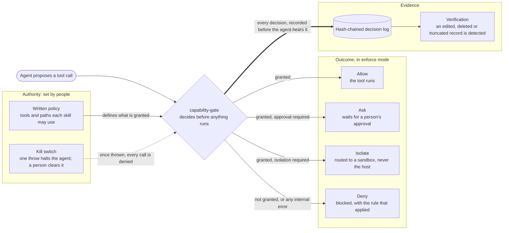

# capability-gate

[](https://github.com/Steck43/capability-gate/actions/workflows/floor.yml)
[](https://securityscorecards.dev/viewer/?uri=github.com/Steck43/capability-gate)
[](LICENSE)

A deny-by-default gate for agent tool calls. Before a tool runs, the agent's
runtime asks the gate, and the gate answers allow, deny, ask or isolate from a
written allowlist of tools and paths per skill. The decision is plain Python
you can read, not a model, and it is written to a hash-chained log before the
answer goes back.



Read it left to right. People set the policy, the gate decides before any tool
runs, the outcome is enforced, and every decision lands on a log an auditor can
verify. In observe mode the gate makes and records the same decisions and blocks
nothing, so a policy can be tuned on real traffic before it is enforced.

## See it work

One command on a fresh clone. No network, no secrets, under a second:

    pip install -r requirements-dev.txt
    make hire-demo

It runs the real gate on a throwaway folder. Output from one run, with the
reasons shortened to fit:

```text
[1 ALLOW     ] read_file work/notes.txt          ALLOW   enforce RAN     allowed by policy
[2 DENY      ] shell (tool not granted)          DENY    enforce blocked tool 'shell' not granted
[2 DENY      ] read_file /etc/passwd (outside)   DENY    enforce blocked path outside allowlist
[2 DENY      ] read_file work/secret-canary.txt  DENY    enforce blocked canary secret in a grant
[2 DENY      ] read_file work/.env (protected)   DENY    enforce blocked protected .env path
[3 KILL      ] shell after throw                 DENY    enforce blocked kill switch thrown
[3 KILL      ] tool_nobody_named after throw     DENY    enforce blocked kill switch thrown
[4 FAILCLOSED] malformed policy (tools: str)     REFUSED enforce blocked PolicyError at load
[4 FAILCLOSED] gate error inside evaluate        DENY    enforce blocked gate error, failing closed
[4 FAILCLOSED] log folder removed, granted call  DENY    enforce blocked log folder removed
[6 OBSERVE   ] shell in observe mode             DENY    observe RAN     tool 'shell' not granted

executed_after_kill = 0
...
RESULT: PASS
```

The run checks 19 expected outcomes and exits non-zero if any one fails.
What each step shows:

| Step | What happens |
|---|---|
| Allow | A granted tool on a granted path runs. |
| Deny | An ungranted tool, a path outside the grant, a canary file and a `.env` file are each blocked before the tool runs. |
| Kill switch | After one `throw`, every tool is denied, including tools nobody named, with no restart. Nothing runs after the throw. |
| Fail closed | A broken policy is refused at load. An error inside the gate is a deny. A missing log folder denies the call and is not quietly re-created. |
| Verify | The hash chain still verifies after the kill. |
| Observe | The same call in observe mode is logged as a deny and allowed to run, so a policy can be built from real traffic before it blocks anything. |

More in one command each:

- `make hire-forge`: rewrite, delete or re-chain a log row; verification
  rejects each one and names the earliest broken row.
- `make hire-pins`: remove each control in a scratch copy; its tests must go
  red.
- `make demo-all`: nine seeded scenarios on synthetic traffic, with the
  counts in the [Proof](#proof) section below. S14 also needs cargo and an
  isolation-layer checkout.

See [demos/hire/DEMO.md](demos/hire/DEMO.md) for the limits of the demo.

## How it fits with the other repos

capability-gate is one of three public repos that work as one system:

- **capability-gate** (this repo) decides each tool call and logs it.
- **[aegis-atoms](https://github.com/Steck43/aegis-atoms)** holds policy
  atoms, a deny-overrides rollup and a judge that may tighten a verdict and
  may not loosen it.
  It sits behind this gate, which holds the live allowlist.
- **[isolation-layer](https://github.com/Steck43/isolation-layer)** is where
  an `isolate` verdict goes: a Firecracker microVM per task under the jailer.
  It is a research build, and the demo rows here run against its stub door,
  not a microVM.

## What it is

`capability_gate.py` is the decider. The rest of the repo connects it to agent
runtimes and checks its output.

- **Policy.** `load_policy` reads an allowlist (see `allowlist.example.yaml`):
  for each skill, the tools it may call and the path globs it may touch, plus a
  `require_approval` list of tools that always get `ask` and an `isolate` list
  of granted tools that always get `isolate` once their paths pass. A tool in
  both lists is refused at load. An unlisted skill, tool or path is denied.
  A policy that does not resolve is refused at load.
- **Decision.** `Gate.evaluate(skill, tool, paths, args=..., trace=...)`
  returns a `Decision` with a verdict (`allow`, `deny`, `ask` or `isolate`),
  a reason and whether it was enforced. Any error inside the decision path is
  a deny.
- **Modes.** In `enforce` a deny blocks. In `observe` the gate decides and logs
  the same way and blocks nothing, so an allowlist can be built from real
  calls before it is switched to enforce.
- **Kill switch.** `Gate.throw(reason)` writes a marker beside the log and one
  THROWN row to the chain. Every later call is denied, in this gate and in any
  other gate on the same log, with no restart. A person clears it by removing
  the marker; the gate never clears it.
- **Decision log.** Each row is chained to the one before it by sha256, with a
  witness of the head and row count and an anchor beside the log.
  `verify_hash_chain(log)` raises on an edit, a deleted row or a cut tail, and
  the gate refuses to append to a log that does not verify. A signed checkpoint
  over the log can be configured (`tests/test_c4_checkpoint.py`).
- **Adapters.** `__init__.py` and `plugin.yaml` register the gate on the Hermes
  `pre_tool_call` hook. `adapters/claude_code_hook.py` runs the same decider as
  a Claude Code `PreToolUse` hook: it exits 2 to block, and every failure
  inside it, including a missing policy or an unwritable log, also exits 2
  (see [adapters/CLAUDE-CODE.md](adapters/CLAUDE-CODE.md)).
- **Isolate route.** In enforce an `isolate` verdict blocks the host run and
  `adapters/isolate_route.py` hands the call to the box door named in
  `isolate_route.yaml`. The door answers with a receipt bound to the call id,
  the decision digest, the task digest and a single-use route ticket; the
  call is still blocked on the host, and the message says whether the box
  advanced, held, dropped or rejected the result. Any route error blocks. In
  observe an `isolate` verdict is logged and the call runs on the host, as
  for any other verdict. If the gate fails to load while the policy file
  lists `isolate` tools, the call blocks in both modes. The Claude Code hook
  queues the task and denies.
- **Report.** `report.py` reads a decision log, after the chain verifies, and
  lists the tools and paths used but not granted, which is how an observe run
  turns into an enforce allowlist.

## How to run it

From a fresh clone, with Python 3 and PyYAML (`pip install -r requirements-dev.txt`):

    make demo-all

That runs every scenario in `demos/scenarios/` against the real gate, prints a
summary table (scenario, control, events, expected, actual, PASS/FAIL, mode)
and writes `out/summary.json` plus one record per scenario in `out/runs/`. It
exits non-zero if any row is FAIL. S14 builds the isolation-layer stub door
with cargo from `../isolation-layer` (or `ISOLATION_LAYER_ROOT`); `make
demo-isolate` runs S14 alone. All traffic is synthetic and generated from
the seed in each scenario file; nothing reads the network or a real log.

    make demo-test

runs the same scenarios as pytest assertions, at their own seed and at a
changed seed, checks that two runs give the same counts, and removes each
scenario's control once to show the row goes red. See
[demos/README.md](demos/README.md).

The full test suite:

    pip install -r requirements-dev.txt
    python3 scripts/run_full_suite.py

The boundary tests load aegis-atoms and isolation-layer at the commits pinned
in `tests/test_gate_boundary.py`. `scripts/run_full_suite.py` finds clones of
both beside this repo, or at `AEGIS_ATOMS_SRC` and `ISOLATION_LAYER_SRC`,
makes detached worktrees at the pins and runs pytest against them. A bare
`python3 -m pytest -q` uses those clones as they stand, so
`test_siblings_pinned` fails unless they sit at the pins.

CI runs `make demo-all` on every push to main and every pull request, then
`scripts/readme_proof.py check`, which fails if any number in the Proof section
below differs from the `out/summary.json` that run just wrote.

## Proof

Generated by `python3 scripts/readme_proof.py write` from `out/summary.json`
after `make demo-all`. Each row and each count line names its scenario and
seed; rerun `make demo-all` to get the same numbers. REAL means the row drives
the real gate (S09 drives the real Claude Code hook as a subprocess). S14 is
STUBBED: it drives the real gate and plugin hook, and the box door is the
isolation-layer stub (`sandbox-demo route`, `real: false`), not a microVM.
S11 is REAL: 500 synthetic SIEM alerts, local dedup and rank, recorded
reasons, no model call. The path is this repo's `demos/`; there is no
sibling defensive-workflows tree.

<!-- proof:start -->
| scenario | seed | result | REAL/STUBBED |
|---|---|---|---|
| S01-baseline-benign | 1301 | PASS | REAL |
| S02-gate-deny-risky-command | 1302 | PASS | REAL |
| S03-policy-allow-deny-ask | 1303 | PASS | REAL |
| S04-kill-switch-mid-run | 1304 | PASS | REAL |
| S08-receipt-chain-tamper | 1308 | PASS | REAL |
| S09-gate-outage | 1309 | PASS | REAL |
| S11-alert-triage-burst | 1311 | PASS | REAL |
| S12-shadow-vs-enforce | 1312 | PASS | REAL |
| S14-isolate-route | 1414 | PASS | STUBBED |

Counts from the same run (`actual` in out/summary.json):

- S01-baseline-benign, seed 1301: events=200, allow=200, ask=0, chain_ok=1, deny=0, executed=200, log_rows=200
- S02-gate-deny-risky-command, seed 1302: events=128, benign_allowed=120, chain_ok=1, executed=120, risky_denied=8, risky_executed=0, risky_with_rule_id=8
- S03-policy-allow-deny-ask, seed 1303: events=84, allow=60, ask=9, ask_executed=0, ask_pending_human=9, chain_ok=1, deny=15, executed=60
- S04-kill-switch-mid-run, seed 1304: events=300, allowed_before_kill=137, calls_after_kill=163, calls_before_kill=137, chain_ok=1, denied_after_kill=163, executed_after_kill=0, halt_marker_present=1, kill_receipts=1
- S08-receipt-chain-tamper, seed 1308: events=20, log_unchanged_after_refusal=3, next_append_refused=3, records_written=20, tamper_cases=3, tamper_detected=3
- S09-gate-outage, seed 1309: events=60, allowed_outside_outage=38, blocked_during_outage=22, calls=60, calls_during_outage=22, decided_after_recovery=15, executed_during_outage=0
- S11-alert-triage-burst, seed 1311: events=500, alerts=500, auto_closed=0, close_recommended=0, duplicates_grouped=280, human_review_queue=220, replay=1, true_positive_in_top_3=1, unique_groups=220
- S12-shadow-vs-enforce, seed 1312: events=110, enforce_blocked=10, enforce_risky_executed=0, flagged_sets_identical=1, same_events_both_runs=1, shadow_executed=110, shadow_would_block=10
- S14-isolate-route, seed 1414: events=59, advanced=6, benign_allowed=40, chain_ok=1, door_chain_rows=51, door_down_blocked=1, door_receipts_real=0, dropped=4, held=2, host_executed_isolate=0, isolate=19, kill_discarded=1, replay_refused=1, reuse_refused=1, routed=18, vestibule_rejected=4
<!-- proof:end -->

## Not shown yet

These are listed in `not_supported` in `out/summary.json` and are not claimed
here:

- S05 secret in prompt: there is no secret redaction hook. The gate keeps
  argument keys, paths and byte lengths in its log and drops argument content;
  it does not redact prompts or count redactions.
- S06 PII in the audit log: there is no PII redaction on the log write path.
  Content is left out of the log, not redacted.
- S10 phishing investigation: that workflow does not exist yet.
- S13 token usage: depends on S10 replay records, which do not exist yet.
  S11 writes usage on its receipt; S13 is not built.
- A real microVM boot: the sandbox side lives in
  [isolation-layer](https://github.com/Steck43/isolation-layer), and its demo
  rows run on a stub VM host today.
- S08 does not assert the exact broken row: the gate reports a broken chain
  or a witness mismatch without a row number. S08 asserts detection and that
  the next append is refused.
- S01 does not count alerts: there is no alerting layer yet.

## Limits

- An attacker running as the same OS user as the agent can rewrite the log, the witness and the anchor together, and capability-gate does not detect it.
  A signed checkpoint covers the rows it signs; rows after the newest
  checkpoint, and a gate with no checkpoint configured, keep this limit. See
  [SECURITY.md](SECURITY.md).
- The gate checks tool names and paths. It does not parse shell command text,
  so tools such as `terminal` belong in `require_approval` or stay ungranted.
- Hermes passes no skill label to the hook, and Claude Code passes none
  either; both adapters judge such calls as the skill `UNLABELED`, which the
  allowlist must grant by name.
- The isolate route runs against a stub VM host: S14 checks the gate side of
  the route and the receipt checks, not a microVM boot. The real door waits
  on a KVM host. S14 does not run isolation-layer `scripts/box_entry.py`;
  `test_one_write_needs_three_receipts` checks that its spent store refuses a
  box ticket handed over twice.
- A plugin that is not loaded mediates nothing, and the gate cannot prove its
  own presence.

## License

MIT. See [LICENSE](LICENSE). Citation metadata is in
[CITATION.cff](CITATION.cff).
