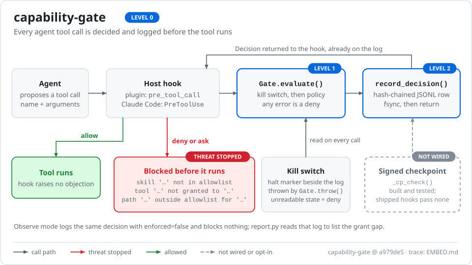
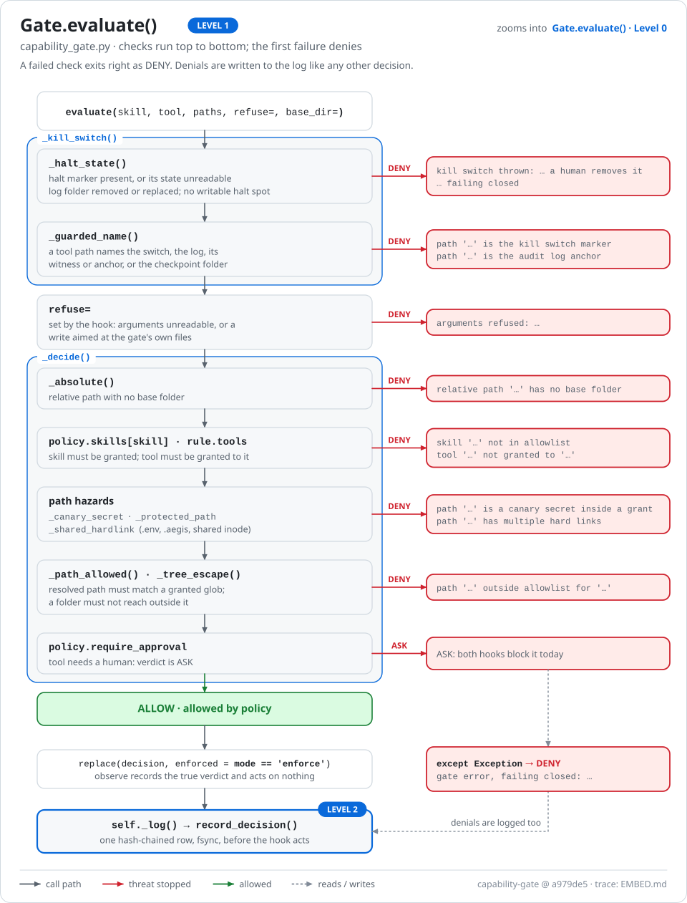
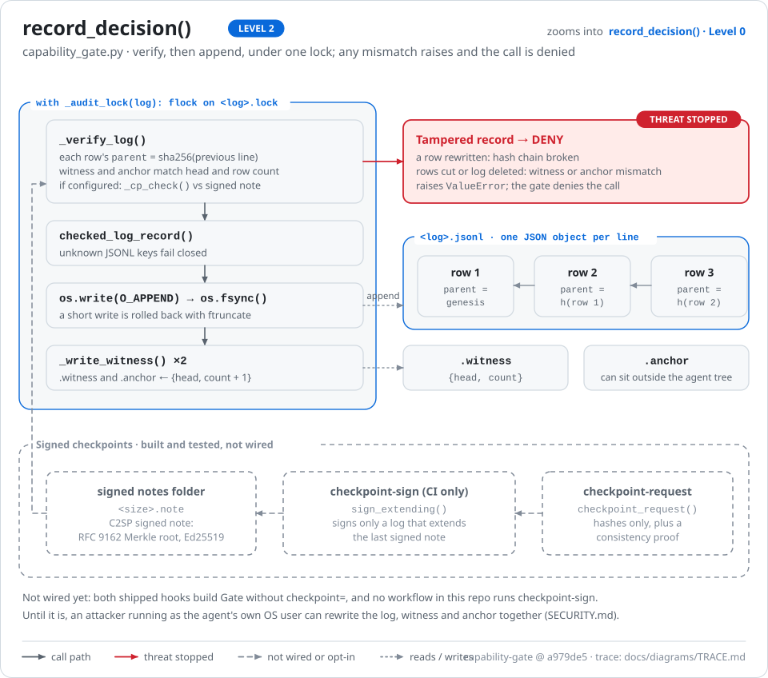

# capability-gate

A deny-by-default gate that decides allow or deny for every AI agent tool call before the tool runs, and writes that decision to a hash-chained log before the call proceeds.

[](https://doi.org/10.5281/zenodo.22018052) (concept DOI for the software record, resolves to the latest release)

## The threat it stops

An agent with file and shell tools can be steered by injected text, a poisoned tool, or its own mistake into reading secrets, writing outside its task, or reaching tools nobody granted it. capability-gate puts a policy decision in front of each call: no grant, no call. When the gate itself breaks (bad payload, unreadable policy, tampered log, a kill switch it cannot read), the answer is deny.

## How it works

<picture>
  <source media="(prefers-color-scheme: dark)" srcset="docs/diagrams/capability-gate-dark.svg">
  
</picture>

<details>
<summary><b>Zoom in:</b> inside <code>Gate.evaluate()</code> and the decision log</summary>

<picture>
  <source media="(prefers-color-scheme: dark)" srcset="docs/diagrams/capability-gate-L1-evaluate-dark.svg">
  
</picture>

<picture>
  <source media="(prefers-color-scheme: dark)" srcset="docs/diagrams/capability-gate-L2-audit-log-dark.svg">
  
</picture>
</details>

Traces for these figures are in `docs/diagrams/TRACE.md`.

- **Policy:** a YAML allowlist of skills, tools and path globs. Anything not granted is denied. Paths are resolved before matching, so `notes/../config.yaml` is judged where it lands.
- **Two modes:** observe decides and logs exactly as enforce would but blocks nothing; enforce acts. `report.py` reads the log and lists the grant gap (tools and paths used but not granted), so the enforce allowlist comes from real behavior.
- **Log check after the decision:** `Gate.evaluate()` makes the decision, then `record_decision()` checks the chain, the witness, and the anchor and appends the row under one lock before the gate returns. A mismatch denies. Each row carries the hash of the row before it.
- **Ask is a block for now:** the policy can return `ask` (reserved for a later human-approval stage). Both hooks turn `ask` into a block today.
- **Claude Code adapter:** `adapters/claude_code_hook.py` maps each Claude Code tool to the argument that names its file. A tool missing from that map, including any MCP tool, is denied even when the allowlist grants it.

## Proof

| Claim | Where it is proven |
|---|---|
| No grant, no call (deny by default) | `test_capability_gate.py`, `tests/test_gate_boundary.py`, `tests/test_cases_table.py` |
| Tamper on the log fails closed (rewrite, truncation, deletion) | `capability_gate.py` `_verify_log`; `tests/test_witness_tamper.py`, `tests/test_issue32_witness.py` |
| Signed checkpoints (RFC 9162 Merkle root, Ed25519 signed note, consistency proof) | `capability_gate.py` checkpoint section and `_cp_check`; `tests/test_c4_checkpoint.py` (22 tests, A1 to A4 attacks, plus strip tests that show the attacks pass when the check is removed) |
| Kill switch beats every grant; an unreadable switch denies | `tests/test_kill_switch.py`, `tests/test_halt_marker.py` |
| A read-only log folder denies (POSIX, non-root) | `tests/test_cc_adapter.py::test_readonly_log_folder_blocks_or_throw_succeeds` |
| `ask` is enforced as a block | `test_adapter.py::test_ask_enforce_blocks` |
| MCP and unlisted tools denied even when granted | `tests/test_cc_adapter.py::test_tool_without_path_schema_denied_even_when_granted` |
| Path checks hold under generated input | `tests/test_path_properties.py` (8 Hypothesis properties) |
| Known-answer tests must actually call the gate | `scripts/kat_lint.py`, `scripts/kat_swap.py`, `tests/test_kat_lint.py`, `tests/test_swap_harness.py` |
| CI guardrails are hash-pinned | `scripts/floor_guard.py`, `.github/floor-pins.json` |

## Measured results

The Linux suite figure is from commit `a979de5` (main, 2026-10-18) and was not rerun on Linux this session. The Windows figure is this branch, Python 3.12, siblings at the CI pins.

| Measure | Result |
|---|---|
| Full test suite (Python 3.12, sibling repos at the CI pins) | Linux, 2026-10-19, not rerun this session: 2,287 passed, 26 skipped, 10 xfailed. Windows rerun this session: 2,285 passed, 17 skipped, 10 xfailed; the rest are a symlink copy error on `harness/s1-in-grant/s1-link` inside the KAT swap harness |
| Stage-1 adversarial lab (`harness/lab_insufficiency_harness.py`) | 19 cases: 8 of 15 deny-expected caught, 7 false allows, 4 correct allows, 0 false denies |
| Floor guard against its own pins | 13 jobs, 25 guard files, 0 violations |

The 10 xfailed tests are known gaps kept as strict expected failures (`xfail_strict = true` in `pytest.ini`), so a gap that quietly closes turns the suite red until someone records it.

## Known limits

- **The lab reports its misses.** 7 of the 15 deny-expected cases are allowed. They are single-call attacks that stay inside a granted tool and path (for example a secret read through an allowed reader, or a payload hidden in an allowed egress tool's arguments). A per-call allowlist cannot see intent; that is the job of a later stage.
- **Same OS user.** An attacker running as the same OS user as the agent can rewrite the log, the witness and the anchor together, and capability-gate does not detect it. Signed checkpoints close this for rows a checkpoint covers, but neither shipped hook passes a checkpoint yet, and no CI job in this repo signs checkpoints yet (the `checkpoint-sign` command exists). Treat checkpoints as built and tested, not live.
- **Floor guard is advisory.** On pull requests the guard script and pins load from the base branch, but the job definition comes from the PR's own `floor.yml`, and the floor guard and KAT lint are not required checks on main. A PR could weaken them. Making both required is a pending repository setting.
- **Pin changes show red on main.** When a merge regenerates the pins (as `a979de5` did for the CI lock), the push run checks the new tree against the parent's pins and reports one violation. The tree passes against its own pins.
- **Read race.** `open_authorized_read` binds an authorized read to the opened file, but the host's own read tool does not call it yet.
- **Not a reference monitor.** Mediation covers the calls that reach the hook while the plugin is loaded. It does not cover the agent's whole lifetime.

## Run the tests

```bash
# Clone aegis-atoms and isolation-layer next to this repo before running
python -m venv .venv && . .venv/bin/activate
pip install --require-hashes -r requirements-ci.lock
# Creates worktrees of aegis-atoms and isolation-layer at the pinned commits, then runs pytest
python scripts/run_full_suite.py -q -n 4

# The Stage-1 lab tally
python harness/lab_insufficiency_harness.py

# Floor guard against this tree's own pins
python -I scripts/floor_guard.py --root . --pins .github/floor-pins.json
```

## Related work

1. **Stecker, L. (2026). *capability-gate* (software, plugin-v0.1.1). Zenodo.** https://doi.org/10.5281/zenodo.22018052
   This repository. The concept DOI always resolves to the latest archived release. Zenodo lists it as software, not as a paper.
2. **Saltzer, J. H., & Schroeder, M. D. (1975). The protection of information in computer systems. *Proceedings of the IEEE*.** https://doi.org/10.1109/PROC.1975.9939
   Borrows fail-safe defaults (deny by default), least privilege and complete mediation. Differs in that mediation covers the calls that reach the `pre_tool_call` hook while the plugin is loaded, and the README says this is not a reference monitor over the agent's whole lifetime.
3. **Dennis, J. B., & Van Horn, E. C. (1966). Programming semantics for multiprogrammed computations. *Communications of the ACM*.** https://doi.org/10.1145/365230.365252
   Borrows the capability idea that a principal acts on what it was granted and nothing else. Differs in that grants live in a central allowlist keyed by skill, not in unforgeable references held by the caller. `open_authorized_read`, which binds an authorized file descriptor, is the closest the code comes to a held capability.
4. **Greshake, K., Abdelnabi, S., Mishra, S., Endres, C., Holz, T., & Fritz, M. (2023). Not what you've signed up for: Compromising Real-World LLM-Integrated Applications with Indirect Prompt Injection. arXiv:2302.12173.** https://arxiv.org/abs/2302.12173
   This is the threat the gate is built around. The gate does not detect injected instructions. It limits what a hijacked call can reach to the tools and paths the skill was granted.
5. **Debenedetti, E., Shumailov, I., Fan, T., Hayes, J., Carlini, N., Fabian, D., Kern, C., Shi, C., Terzis, A., & Tramèr, F. (2025). Defeating Prompt Injections by Design. arXiv:2503.18813.** https://arxiv.org/abs/2503.18813
   Shares the premise that a deterministic check outside the model makes the policy decision. Differs in that the gate does not track data flow or provenance and runs no custom interpreter. It checks each call's tool and paths against per-skill grants.
6. **Debenedetti, E., Zhang, J., Balunović, M., Beurer-Kellner, L., Fischer, M., & Tramèr, F. (2024). AgentDojo: A Dynamic Environment to Evaluate Prompt Injection Attacks and Defenses for LLM Agents. arXiv:2406.13352.** https://arxiv.org/abs/2406.13352
   Tests against it, partially. `adapters/agentdojo_adapter.py` maps four tool families onto the gate's hook and strips metadata supplied by tool output, and unit tests cover that mapping. No live AgentDojo suite has been run, so no utility or attack-success numbers are claimed.
7. **Crosby, S. A., & Wallach, D. S. (2009). Efficient Data Structures for Tamper-Evident Logging. USENIX Security Symposium.** https://www.usenix.org/legacy/event/sec09/tech/full_papers/crosby.pdf
   Borrows tamper-evident logging. The decision log is hash-chained and checked against a witness and an anchor. The documented limit is that a writer running as the same OS user can rewrite all three together.
8. **Laurie, B., Messeri, E., & Stradling, R. (2021). RFC 9162: Certificate Transparency Version 2.0. IETF.** https://www.rfc-editor.org/rfc/rfc9162.html
   Borrows the Merkle tree and consistency proofs. The optional signed checkpoint uses the [C2SP tlog-checkpoint](https://c2sp.org/tlog-checkpoint) format over an RFC 9162 Merkle root, and the signing job refuses a log that does not extend the last signed one. Rows written after the newest checkpoint stay uncovered, and neither hook configures a checkpoint yet.

## Security

See `SECURITY.md` for private reporting and the same-OS-user limit.
